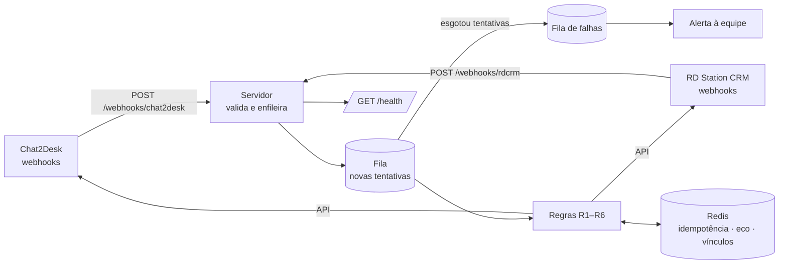

# Chat2Desk ↔ RD Station CRM — sincronização bidirecional

Implementação de referência em **TypeScript/Node.js** do desenho que proponho para integrar o
Chat2Desk ao RD Station CRM nos dois sentidos, sem duplicar contatos e negociações e sem eco
entre as regras.

> **Sobre este repositório:** é uma referência técnica escrita para demonstrar o desenho, não o
> código de um cliente. A lógica das regras (dedupe por telefone, idempotência, bloqueio de eco,
> fila com novas tentativas) é completa e coberta por testes que rodam contra simuladores das
> duas ferramentas. Os adaptadores HTTP das APIs reais estão prontos como esqueleto; caminhos,
> payloads de webhook e IDs de campos são confirmados no M1, com as contas reais em ambiente de teste.

```bash
npm install
npm test        # 37 testes: as seis regras, fila, telefone e webhooks
npm run demo    # executa as seis regras ponta a ponta, sem credenciais
```

Saídas já geradas: [`docs/test-output.txt`](docs/test-output.txt) · [`docs/demo-output.txt`](docs/demo-output.txt)

---

## Arquitetura



**Por que API + webhooks, e não o Construtor de chatbot:** a lógica fica fora do fluxo do bot
que já atende, versionada no repositório e testável. O bot atual e o fluxo do n8n continuam
exatamente como estão.

## As seis regras

| Regra | Onde | Como fica garantida |
|---|---|---|
| **R1** contato novo cria contato + negociação, sem duplicar | `rules.ts › resolveContactAndDeal` | busca antes de criar + processamento serializado por telefone (duas mensagens simultâneas não criam dois contatos) |
| **R2** etiqueta de prioridade → etapa 2, uma vez | `rules.ts › onTagAdded` | chave de idempotência por negociação + checagem da etapa atual |
| **R3** campo muda → CRM; vazio não apaga | `rules.ts › onFieldsChanged` | campos vazios descartados antes de enviar; só campos do mapa |
| **R4** fim do atendimento → nota única com data e canal | `rules.ts › onDialogClosed` | chave de idempotência por atendimento |
| **R5** etapa muda no CRM → Chat2Desk, sem disparar R2 | `rules.ts › onCrmStageChanged` | bloqueio de eco (abaixo) |
| **R6** cliente que volta reaproveita negociação aberta; mesmo telefone = um contato | `phone.ts` + `resolveContactAndDeal` | telefone canônico + busca por todas as variações (com/sem DDI, com/sem 9) |

## Bloqueio de eco (R2 ↔ R5)

O ponto mais delicado do projeto. São três camadas, cada uma suficiente sozinha no caso comum:

1. **Separação estrutural.** Por padrão, a R5 grava a etapa num **campo próprio** do Chat2Desk
   (`etapa_crm`), não na etiqueta de prioridade. A R2 só escuta etiquetas, então a escrita da R5
   não tem como acioná-la. A R3 também ignora esse campo.
2. **Assinatura da própria escrita** (`echoGuard.ts`). Antes de gravar, a integração registra no
   Redis o que vai gravar — por exemplo `crm:deal:123:stage:etapa-2` — com validade curta
   (10 min). Quando o webhook correspondente volta, a assinatura é encontrada, consumida e o
   evento é descartado.
   - A assinatura inclui o **valor**: se um consultor mover a mesma negociação para outra etapa
     segundos depois, o evento dele não bate e passa normalmente (há teste para isso).
   - Consumo único e TTL: uma marca que nunca voltou expira sozinha.
   - Se a escrita falhar, a marca é desfeita, para não engolir um evento legítimo depois.
3. **"Etapa realmente mudou?"** O CRM avisa qualquer alteração da negociação; a R5 só repassa
   se a etapa for diferente da última enviada.

Se no M1 vocês preferirem que a etapa volte como **etiqueta**, o modo `tag` já existe e o teste
cobre o pior caso (etapa mapeada para a própria etiqueta de prioridade): a camada 2 bloqueia.

## Telefone (chave única)

`phone.ts` converte qualquer grafia para um formato canônico (só dígitos, com DDI e, em celular
brasileiro, com o nono dígito). Para não criar duplicado com os ~58 mil contatos já existentes,
a busca no CRM tenta também as variações sem DDI e sem o 9. O fluxo do n8n pode usar a mesma
função para que tudo caia na mesma chave.

## Falhas: nada se perde em silêncio

- O webhook só enfileira e responde na hora; reenvio do mesmo evento é descartado.
- Erro → nova tentativa com espera exponencial.
- Esgotou → **fila de falhas** + alerta (`ALERT_WEBHOOK_URL`: Slack, Teams, e-mail).
- `POST /admin/replay` reprocessa a fila de falhas depois de corrigida a causa.
- `GET /health` mostra recebidos, processados, em nova tentativa e falhas.
- As chamadas ao RD passam por um limitador de requisições por minuto (picos de fim de expediente).

Nesta referência a fila roda em processo; em produção a mesma interface fica sobre BullMQ/Redis,
para sobreviver a reinícios.

## Convivência com o que já existe

- **Bot atual do Chat2Desk:** intocado (a integração não usa o Construtor).
- **Fluxo n8n:** não é alterado; as duas etiquetas dele ficam em `ignoredTagIds` e nunca disparam regra.
- **Painel interno:** a integração só cria o campo `etapa_crm`; nada é renomeado ou apagado.

## Estrutura

```
src/
  phone.ts            padronização de telefone + variações de busca
  rules.ts            as seis regras
  echoGuard.ts        bloqueio de eco
  queue.ts            fila, novas tentativas, fila de falhas
  store.ts            Redis (produção) / memória (testes)
  mutex.ts            serialização por telefone
  server.ts           webhooks, /health, /admin/replay
  adapters/
    rdcrm/http.ts     API do RD Station CRM (esqueleto, validado no M1)
    chat2desk/http.ts API do Chat2Desk (esqueleto, validado no M1)
    webhooks.ts       payload bruto -> eventos internos
    memory/           simuladores usados nos testes e na demo
config/integration.example.json   etapas, etiquetas e mapa de campos (fechado no M1)
test/                 testes das regras, fila, telefone e webhooks
```

## Configuração

Copie `.env.example` para `.env`. Nenhuma credencial vai para o código. O mapa de campos, as
etapas e as etiquetas ficam em `config/integration.example.json` e são preenchidos no M1.
